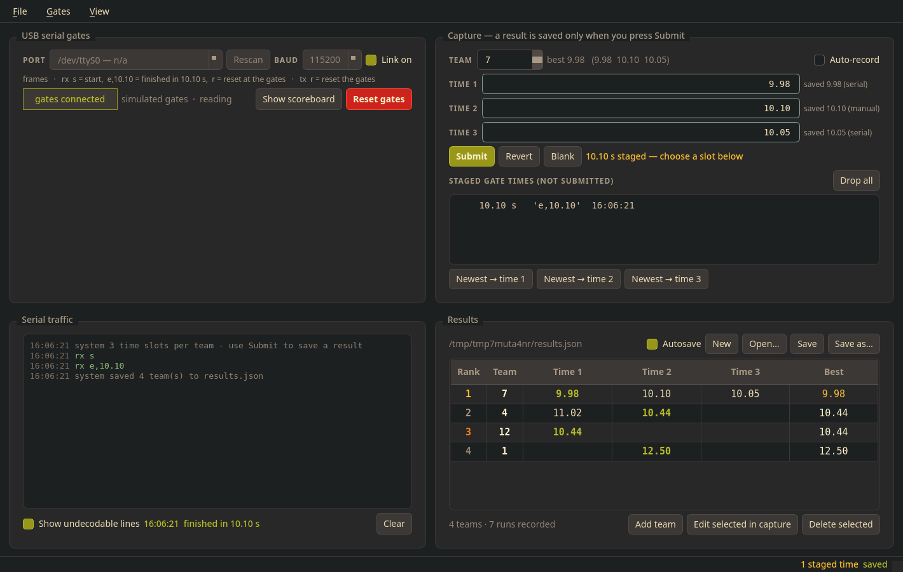
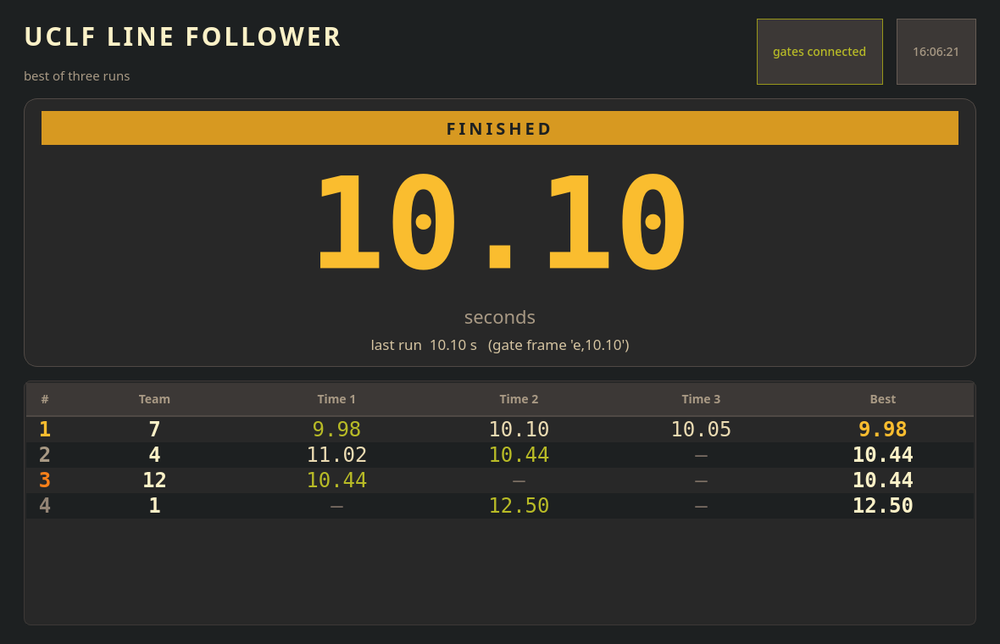

# UCLF Line Follower Scoreboard

Scoreboard for a line-following competition: a **scoring desk** for the operator and a
**projected scoreboard** for the audience, both in dark gruvbox. Race times arrive over
USB serial from the gate MCU; the operator assigns them to teams, and teams are ranked
by their best of up to three runs.

```
python -m uclf              # real gates on the detected USB serial port
python -m uclf --mock       # no hardware: drive the gates from a simulator window
```

| Scoring desk | Projected scoreboard |
| --- | --- |
|  |  |

---

## Contents

| Path | What it does |
| --- | --- |
| `uclf/timeutil.py` | Race times as integer centiseconds (10 ms resolution), parsing/formatting |
| `uclf/protocol.py` | The gate ASCII protocol: `s`, `e,10.10`, `r` -> `Event` objects |
| `uclf/results.py` | `ResultStore`: teams, three time slots, ranking, JSON persistence, autosave |
| `uclf/links.py` | `SerialLink` (pyserial worker thread, hot-plug safe) and `SimulatedLink` |
| `uclf/theme.py` | Gruvbox palette + the Qt stylesheet |
| `uclf/input_window.py` | Scoring desk: serial pane, capture form, results table, file actions |
| `uclf/scoreboard_window.py` | Projected board: giant timer + ranked table |
| `uclf/gate_sim.py` | Optional gate-simulator window (used by `--mock`) |
| `uclf/app.py` | Command line, settings, wiring of store + link + windows |
| `tools/mock_gates.py` | Fake MCU on a pty, for testing the real serial path without hardware |
| `tests/` | 132 pytest tests: models, protocol, serial hot-plug, both windows |
| `examples/results.example.json` | a hand-written results file in the on-disk format |

## Installing

```bash
python3 -m venv .venv && .venv/bin/pip install -r requirements.txt
# or: pip install -e .
```

Requirements: Python 3.10+, `qtpy`, a Qt binding (`PyQt6`, or `PySide6`), and `pyserial`
for real gates. The GUI works with any binding qtpy supports, and the scoreboard can be
run on a second machine with `--mock` if you only want to display results.

## Using it

### Scoring desk

* **USB serial gates** - pick the port (or type a device path), set the baud rate, and
  tick *Link on*. Unplugging the cable is safe: the link reports the loss, keeps
  retrying, and resumes by itself when the device returns.
* **Serial traffic** - every received line (`rx`), every command sent (`tx`), plus
  decoded status. Undecodable lines are logged separately and never applied.
* **Capture** - the team number plus three time slots. A finished run is typed into the
  next empty slot; **nothing is saved until you press Submit** (`Ctrl+Return`). Times
  that did not fit stay in *staged gate times* until you place them (`Newest -> time N`)
  or drop them. *Auto-record* is the opt-in shortcut that writes incoming times straight
  into the selected team's next free slot.
* **Results** - every saved time is editable: change a cell in the table (or the team
  number, to rename a team) and it is applied immediately. `Open…` / `Save` /
  `Save as…` work on the results file, and *Autosave* writes it after every change.
* **Reset gates** (`Ctrl+R`) - sends `r` to the gates and stops the scoreboard timer.

Shortcuts: `Ctrl+R` reset, `Ctrl+B` show scoreboard, `Ctrl+Return` submit.

### Scoreboard

Rows are ordered fastest first: rank, team number, all three times, best time.
The big timer counts up when `s` arrives and freezes on the exact number from the
`e,<time>` frame. `r` - from the gate box or from the desk's reset button - clears it.

`F`/`F11` fullscreen, `Esc` windowed, `+`/`-` type size, `R` clear the timer, `Q` close.
Move the window to the projector screen once; its geometry is remembered.

`--scoreboard-only` is for a machine that only displays results: the desk still exists
(so the serial link keeps working and staged times wait for you), it is just not shown.
Move the window to the projector screen once; its geometry is remembered.

### Command line

```
--port PATH       USB serial device (default: remembered choice, else auto-detect)
--baud N          baud rate (default 115200)
--results FILE    results file (default ./results.json)
--mock            simulate the gates instead of opening a port
--gates-off       start with the serial link switched off
--no-autosave     only save when asked
--scoreboard-only show just the projected board
--fullscreen      show the board full screen
--scale 0.4..3    board type scale
--list-ports      print the serial ports found here and exit
```

## Results file

`results.json` is plain JSON; times are **integer centiseconds** (10 ms resolution, no
float rounding surprises). A save writes a temp file and `os.replace`s it over the
target, and keeps the previous version as `results.json.bak`.

```json
{
  "format": "uclf-scoreboard",
  "version": 1,
  "unit": "centiseconds (1/100 s)",
  "teams": [
    {"team": 7, "times": [1010, 985, null], "sources": ["serial", "manual", "none"]}
  ]
}
```

`sources` records where each time came from (`serial`, `manual`, `none`) and is the only
provenance kept; blank slots are `null`, so a team can be registered before it runs.

## Gate protocol

| Direction | Frame | Meaning |
| --- | --- | --- |
| gates -> PC | `s\n` | start of a run - the big timer counts up |
| gates -> PC | `e,10.10\n` | end of run, 10.10 s elapsed (10 ms steps, arbitrary seconds) |
| both ways | `r\n` | reset - pressed at the gates, or commanded by the desk |

Parsing is tolerant of `\r`, surrounding whitespace, upper/lower case and `e:10.10` /
`e=10.10` separators; anything else is logged as undecodable and ignored. A run of junk
without a newline is dropped rather than buffered forever.

## Testing without hardware

```bash
python -m pytest -q                # full suite, head-less (offscreen Qt)
python tools/mock_gates.py         # interactive fake MCU on a pty
python -m uclf --list-ports        # what serial ports does this machine see
```

`mock_gates.py` prints a device path (default symlink `/tmp/UCLF-GATES`); point the desk
at it and type `s`, `e 10.10`, `r`, or `auto 5` for random runs. `--mock` skips the
serial layer entirely and injects frames straight into the app.
